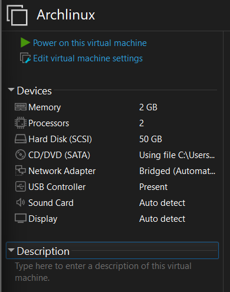
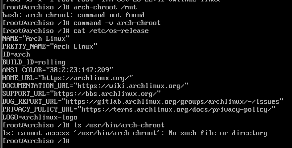
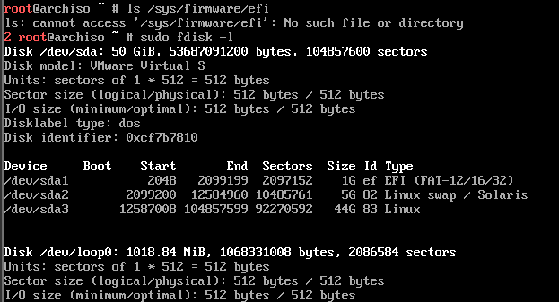
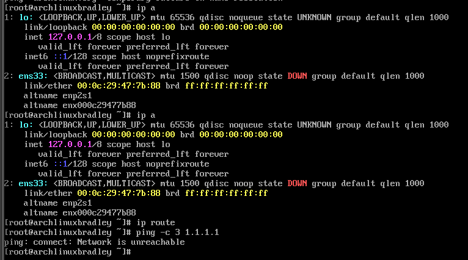
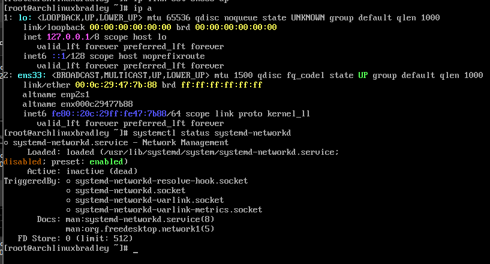
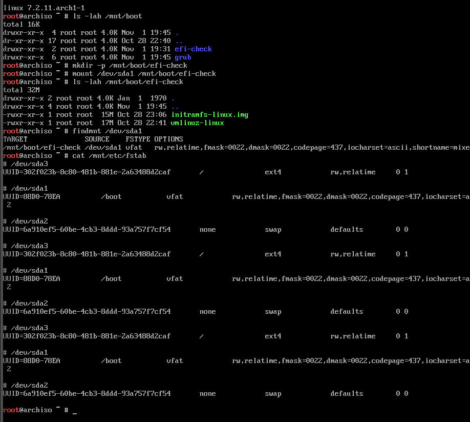
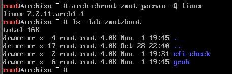
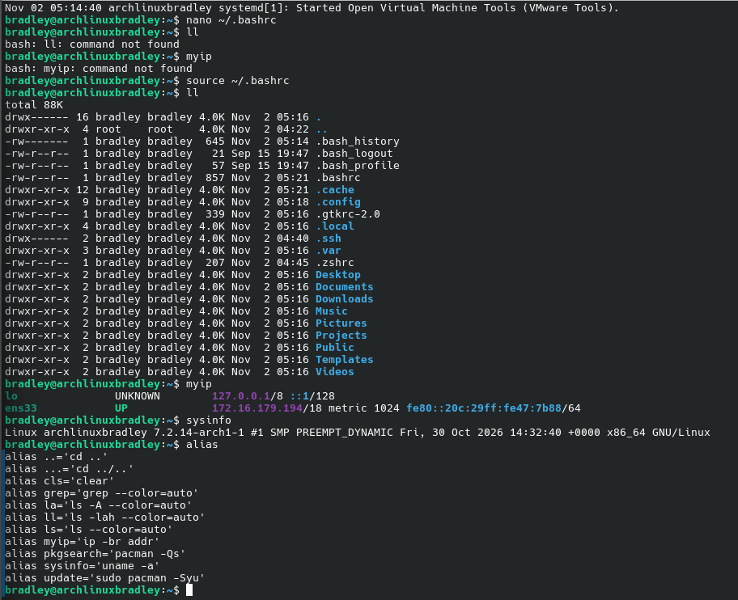

# Arch Linux Installation and Configuration

**Documentation date:** November 1, 2026  
**Platform:** VMware virtual machine  
**Architecture:** x86-64  
**Operating system:** Arch Linux  
**Desktop environment:** KDE Plasma  
**Primary user:** `bradley`

## 1. Setting Up the Virtual Machine

The installation used a VMware virtual machine with a **50 GB SCSI virtual disk**, **2 GB RAM**, and **2 virtual processors**. The machine boots in **legacy BIOS mode**, not UEFI. Networking was later verified through the `ens33` interface.

```bash
lsblk -o NAME,SIZE,TYPE,FSTYPE,MOUNTPOINTS
lsblk -f
ip link show
```

These commands identify the virtual disk, partitions, mounts, and network interfaces.



*Figure 1. VMware VM configuration: 2 GB memory, 2 processors, and a 50 GB SCSI disk.*

## 2. Partitioning and Mounting the Disk

The 50 GB virtual disk was `/dev/sda`, using an **MBR (dos)** partition table:

| Partition | Approximate size | Purpose |
|---|---:|---|
| `/dev/sda1` | 1 GB | FAT32, mounted at `/boot` |
| `/dev/sda2` | 5 GB | Swap |
| `/dev/sda3` | 44 GB | Root filesystem (`/`) |

Unlike the ARM template, this was not an EFI/GPT installation. The following commands show the mount layout used during installation and troubleshooting:

```bash
lsblk -f
mount /dev/sda3 /mnt
mkdir -p /mnt/boot
mount /dev/sda1 /mnt/boot
swapon /dev/sda2
```

The mount order matters because the bootloader configuration must be generated with `/boot` correctly mounted.



*Figure 2. Partition and disk information recorded during setup.*

## 3. Installing the Base System

The system uses standard **Arch Linux for x86-64**, rather than Arch Linux ARM. During troubleshooting, the installed system was inspected from the live environment using `arch-chroot`. The kernel files and operating-system identity were checked.

```bash
arch-chroot /mnt
cat /etc/os-release
ls -lah /mnt/boot
pacman -Q linux
```



*Figure 3. Checking the installed Arch Linux system in chroot.*

## 4. Configuring the System, Users, and Networking

Two accounts, `bradley` and `codi`, were created. The `bradley` account was verified to have a home directory, membership in the `wheel` group, and sudo access. The exact group membership of `codi` should be verified independently. The sudoers rule below does **not** add users to `wheel`; it grants sudo privileges to users who already belong to that group.

```bash
id bradley
id codi
getent passwd bradley codi
sudo whoami
sudo visudo
```

Sudoers entry:

```text
%wheel ALL=(ALL:ALL) ALL
```

The VMware network interface `ens33` was initially down. It was brought up manually, and persistent networking was configured with `systemd-networkd` and `systemd-resolved`.

```bash
sudo ip link set ens33 up
sudo nano /etc/systemd/network/20-wired.network
```

Contents of `/etc/systemd/network/20-wired.network`:

```ini
[Match]
Name=ens33

[Network]
DHCP=yes
DNS=1.1.1.1
DNS=1.0.0.1
Domains=~.

[DHCPv4]
UseDNS=no
```

```bash
sudo systemctl enable --now systemd-networkd
sudo systemctl enable --now systemd-resolved
sudo ln -sf /run/systemd/resolve/stub-resolv.conf /etc/resolv.conf
ping -c 3 1.1.1.1
ping -c 3 archlinux.org
```

Both IP connectivity and DNS resolution were confirmed, including after a reboot.



*Figure 4. Network interface and connectivity troubleshooting.*



*Figure 5. Network configuration and DNS diagnostics.*

## 5. Installing KDE Plasma Desktop

KDE Plasma was installed as the graphical desktop environment, with **SDDM** as the login manager, **Konsole** as the terminal, and **Dolphin** as the file manager.

```bash
sudo pacman -Syu
sudo pacman -S plasma-meta sddm konsole dolphin
sudo systemctl enable sddm.service
sudo systemctl set-default graphical.target
systemctl get-default
sudo reboot
```

The package installation produced no reported errors. After reboot, KDE Plasma launched successfully, and the default boot target was configured as `graphical.target`.

## 6. Configuring and Repairing the Bootloader

This virtual machine uses **BIOS boot with GRUB**, not UEFI with systemd-boot. Initially, the installation opened a `grub>` command prompt instead of displaying a normal boot menu. The GRUB configuration had been generated without the intended `/boot` partition mounted.

The root and boot partitions were mounted in the correct order, the installed system was entered with `arch-chroot`, and GRUB was reinstalled and regenerated.

```bash
mount /dev/sda3 /mnt
mount /dev/sda1 /mnt/boot
arch-chroot /mnt
grub-install --target=i386-pc --boot-directory=/boot --recheck /dev/sda
grub-mkconfig -o /boot/grub/grub.cfg
ls -lah /boot
```

The regenerated GRUB configuration detected the Linux kernel and initramfs. After disconnecting the installation ISO, Arch Linux booted successfully from the virtual disk.



*Figure 6. Boot partition and GRUB directory inspection.*



*Figure 7. GRUB and mount troubleshooting output.*

## 7. Installing Zsh, SSH, Terminal Colors, and Aliases

### Zsh

The assignment required an additional shell, but did not require replacing Bash as the default. Zsh was installed and configured, while Bash remained the login shell.

```bash
sudo pacman -S zsh
zsh --version
nano ~/.zshrc
```

The following configuration was added to `~/.zshrc`:

```zsh
autoload -Uz colors && colors
PROMPT='%F{green}%n@%m%f:%F{blue}%~%f %# '
alias ls='ls --color=auto'
alias grep='grep --color=auto'
```

### Bash colors

Because Bash remained the active login shell, a colored prompt was also configured in `~/.bashrc`:

```bash
nano ~/.bashrc
```

```bash
PS1='\[\e[1;32m\]\u@\h\[\e[0m\]:\[\e[1;34m\]\w\[\e[0m\]\$ '
alias ls='ls --color=auto'
alias grep='grep --color=auto'
```

```bash
source ~/.bashrc
```

The username and hostname appeared in green, and the working directory appeared in blue.

### OpenSSH

The OpenSSH server was installed, enabled, and tested with a local connection:

```bash
sudo pacman -S openssh
sudo systemctl enable --now sshd
systemctl status sshd
ssh bradley@localhost
exit
```

### Bash aliases

The following aliases were added to `~/.bashrc`:

```bash
alias ll='ls -lah --color=auto'
alias la='ls -A --color=auto'
alias ..='cd ..'
alias ...='cd ../..'
alias update='sudo pacman -Syu'
alias pkgsearch='pacman -Qs'
alias myip='ip -br addr'
alias cls='clear'
alias sysinfo='uname -a'
```

They were activated and tested using:

```bash
source ~/.bashrc
ll
myip
sysinfo
alias
```

The first attempts to run `ll` and `myip` returned `command not found` because the Bash configuration had not yet been loaded. Both worked after sourcing `~/.bashrc`.



*Figure 8. Successful Bash color prompt and aliases; `ens33` has address `172.16.179.194`.*

## 8. VMware Tools and Final Testing

The `open-vm-tools` package was installed to improve VMware guest integration. The `vmtoolsd` service was enabled and confirmed to be running.

```bash
sudo pacman -S open-vm-tools
sudo systemctl enable --now vmtoolsd.service
systemctl status vmtoolsd.service
systemctl get-default
ps -p $$ -o comm=
echo $SHELL
ip -br addr
```

During the recorded test, `ens33` was up with IP address `172.16.179.194/18`. Bash remained the active/default shell, while Zsh was installed separately. KDE Plasma login and desktop operation were confirmed interactively; a screenshot of the running KDE desktop was not included in the source document.

## 9. Problems Encountered and Resolutions

### Problem 1: GRUB opened to a command prompt instead of booting Arch Linux

**Problem:** The initial GRUB configuration was generated while the intended `/boot` partition was not mounted. The boot menu therefore could not locate the installed Linux kernel and initramfs.

**Resolution:** The root and boot partitions were mounted in the correct order. The installed system was entered with `arch-chroot`, and GRUB was reinstalled and regenerated for legacy BIOS boot.

```bash
mount /dev/sda3 /mnt
mount /dev/sda1 /mnt/boot
arch-chroot /mnt
grub-install --target=i386-pc --boot-directory=/boot --recheck /dev/sda
grub-mkconfig -o /boot/grub/grub.cfg
```

**Result:** GRUB detected the kernel and initramfs, and Arch Linux booted successfully from the virtual disk.

### Problem 2: Package updates failed in the live installation environment

**Problem:** Package updates were attempted while the system was still running from the Arch installation ISO (`airootfs`). The live environment lacked sufficient writable space for the operation.

**Resolution:** The installed Arch Linux system was booted rather than continuing to update the live installation environment.

**Result:** Package management proceeded successfully within the installed operating system.

### Problem 3: The VMware network interface was down

**Problem:** The `ens33` interface initially showed a `DOWN` state, preventing network connectivity.

**Resolution:** The interface was brought up manually, and `systemd-networkd` was enabled to manage the connection persistently.

```bash
ip link set ens33 up
systemctl enable --now systemd-networkd
ip -br addr
```

**Result:** The interface obtained connectivity and remained configured after reboot.

### Problem 4: DHCP failed because of a configuration typo

**Problem:** The network configuration mistakenly used `DDHCP` instead of `DHCP`, preventing the expected DHCP behavior.

**Resolution:** The directive in `/etc/systemd/network/20-wired.network` was corrected to `DHCP=yes`. The final configuration also specified Cloudflare DNS servers and disabled DHCP-provided DNS settings.

```bash
nano /etc/systemd/network/20-wired.network
# Correct directive: DHCP=yes
ping -c 3 1.1.1.1
ping -c 3 archlinux.org
```

**Result:** Successful pings to an IP address and a hostname confirmed routing and DNS resolution.

### Problem 5: DNS resolution needed persistent configuration

**Problem:** DNS resolution required a persistent resolver configuration that would survive restarting the virtual machine.

**Resolution:** `systemd-resolved` was enabled, and `/etc/resolv.conf` was linked to its stub resolver.

```bash
systemctl enable --now systemd-resolved
ln -sf /run/systemd/resolve/stub-resolv.conf /etc/resolv.conf
```

**Result:** DNS resolution continued working after reboot.

### Problem 6: Zsh was installed, but Bash remained the login shell

**Problem:** Zsh had been installed and customized, but `echo $SHELL` still indicated Bash. Consequently, Zsh-specific prompt settings did not automatically apply to Bash sessions.

**Resolution:** Because the assignment required only an additional shell, Bash was retained as the default. The colored prompt was added separately to `~/.bashrc`.

```bash
zsh --version
echo $SHELL
ps -p $$ -o comm=
nano ~/.bashrc
```

**Result:** Zsh was available, while the active Bash terminal displayed the intended colors.

### Problem 7: Custom aliases returned `command not found`

**Problem:** The aliases were saved in `~/.bashrc` but had not yet been loaded in the active terminal session. Commands such as `ll` and `myip` initially failed.

**Resolution:** The Bash configuration was reloaded:

```bash
source ~/.bashrc
ll
myip
sysinfo
alias
```

**Result:** The aliases worked correctly, producing a detailed directory listing, network interface addresses, and kernel information.

## Conclusion

The Arch Linux installation successfully booted in VMware after GRUB repair. Persistent networking, user accounts and sudo, Zsh, OpenSSH, colored Bash prompts and aliases, KDE Plasma graphical startup, and VMware Guest Tools were configured. The terminal screenshots demonstrate working aliases, network connectivity, and the customized terminal prompt.

## References

- [ArchWiki — Installation Guide](https://wiki.archlinux.org/title/Installation_guide)
- [ArchWiki — GRUB](https://wiki.archlinux.org/title/GRUB)
- [ArchWiki — KDE Plasma](https://wiki.archlinux.org/title/KDE)
- [ArchWiki — SDDM](https://wiki.archlinux.org/title/SDDM)
- [ArchWiki — OpenSSH](https://wiki.archlinux.org/title/OpenSSH)
- [ArchWiki — systemd-networkd](https://wiki.archlinux.org/title/Systemd-networkd)
- [ArchWiki — Zsh](https://wiki.archlinux.org/title/Zsh)
- [ArchWiki — Bash](https://wiki.archlinux.org/title/Bash)
